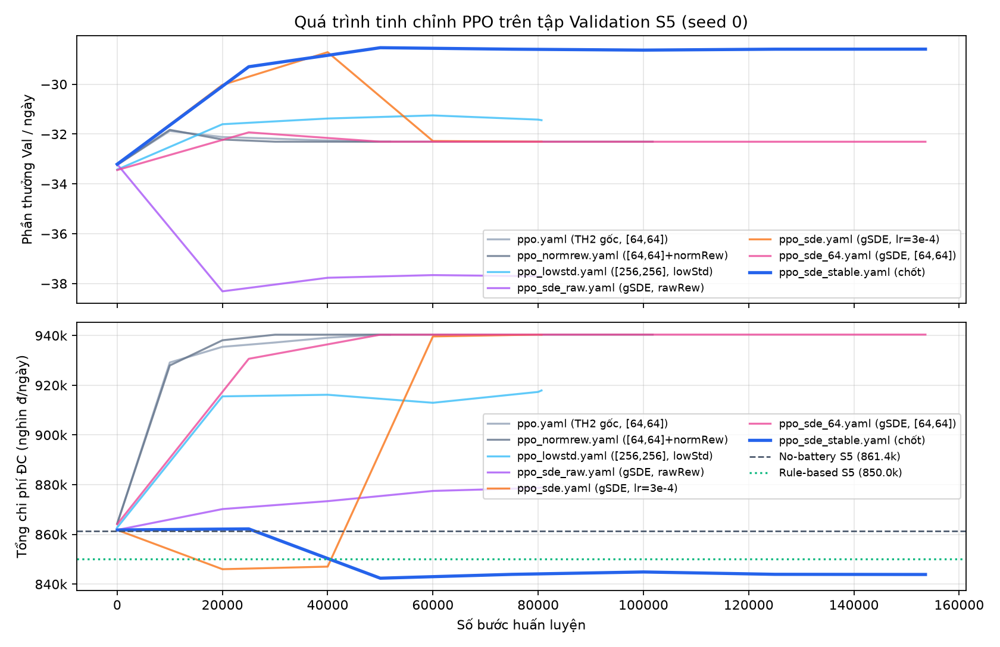
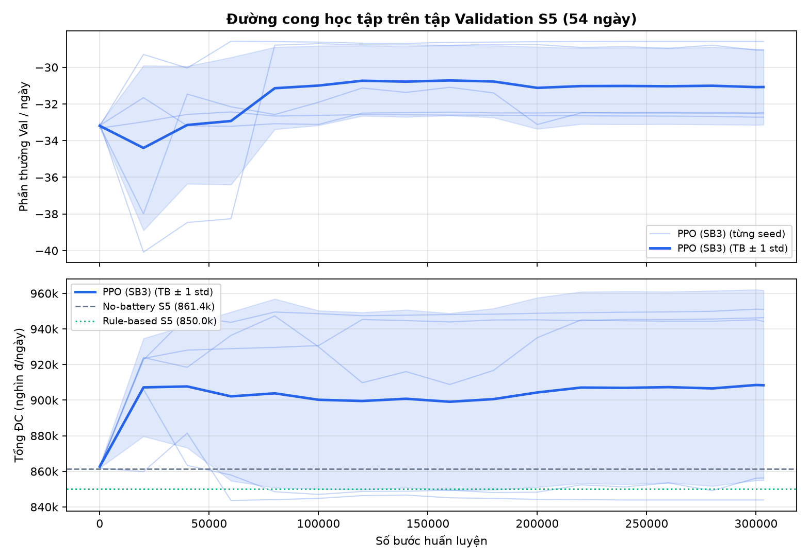
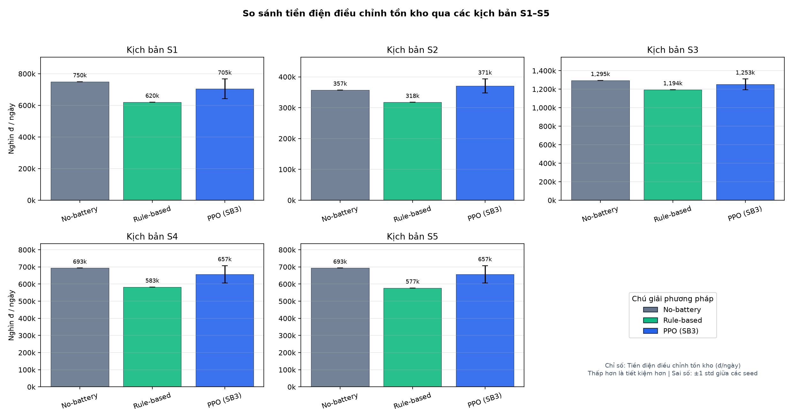
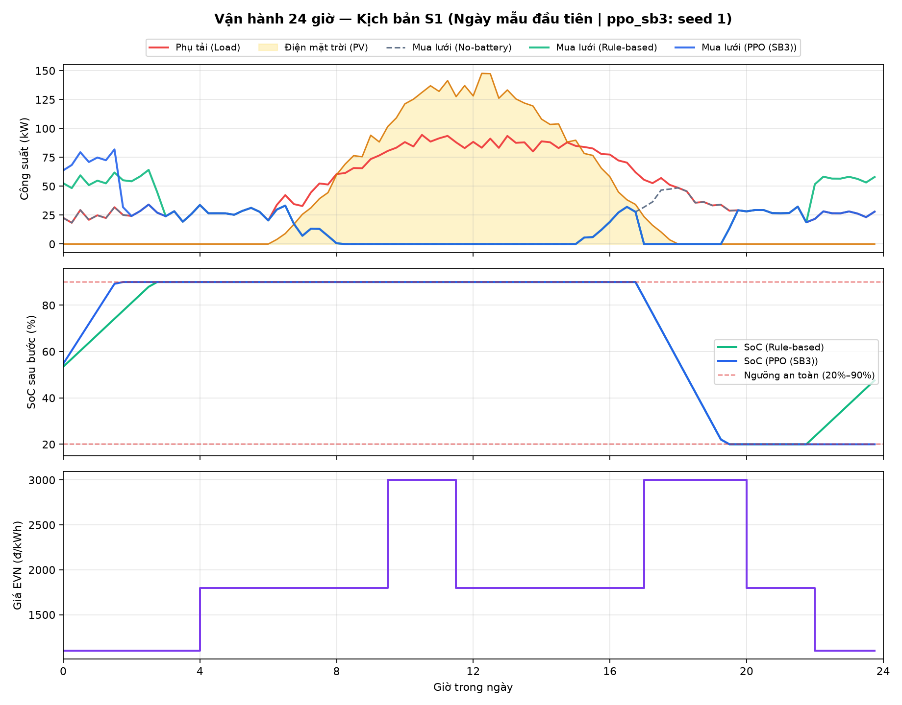
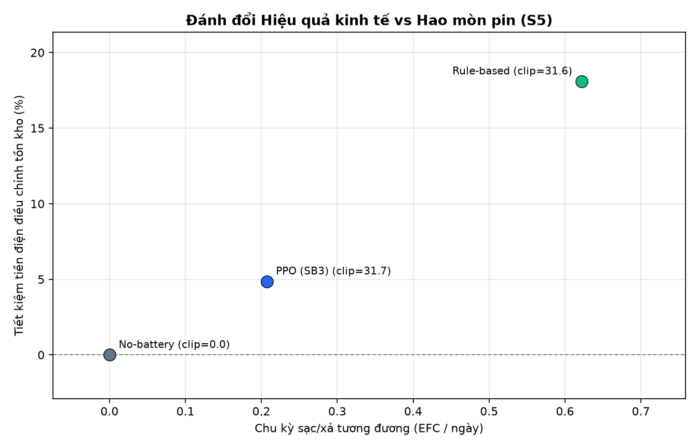

# Thuật toán PPO & Pipeline Đánh Giá Tổng Hợp (Nguyễn Tùng Dương)

Tài liệu tổng hợp thiết kế mã nguồn, quá trình tinh chỉnh trên tập Validation, kết quả thực nghiệm chính thức (5 seeds × 300.000 bước) trên Validation và Test, cùng hướng dẫn ghép nối cho các thành viên khác (SAC, TD3, DDQN) trong đồ án **SEMS-RL**.

---

## 1. Phạm vi bàn giao & Cấu trúc mã nguồn

| Tệp | Vai trò |
| --- | --- |
| [`sems_rl/experiments/protocol.py`](../sems_rl/experiments/protocol.py) | Giao thức dùng chung `sems-daily-v1` (tương thích `sac-daily-v1` của Trường): `ScenarioWrapper` (S1–S5, xử lý quan sát cuối ngày & biên phân vùng), `infer_run_identity`, `load_policy_from_run`, `episode`, `episode_metrics` (KPI Bảng 6 + điều chỉnh tồn kho), `aggregate_results`, `bootstrap_ci`, vẽ biểu đồ. |
| [`sems_rl/agents/ppo.py`](../sems_rl/agents/ppo.py) | `PPOConfig`, `linear_lr_schedule`, `PPOAgentWrapper`, `load_ppo_model` chuẩn hóa giao diện `predict(obs, deterministic=True)` và clip hành động liên tục về `[-1, 1]`. |
| [`configs/ppo.yaml`](../configs/ppo.yaml) | Cấu hình PPO gốc theo Báo cáo TH2 (`[64, 64]`, `tanh`, `n_envs=4`, `n_steps=480`). |
| [`configs/ppo_sde_stable.yaml`](../configs/ppo_sde_stable.yaml) | **Cấu hình PPO tối ưu đã chốt trên Validation** (`[256, 256]`, `tanh`, `n_envs=8`, `n_steps=480`, `batch_size=256`, `use_sde=True`, `sde_sample_freq=8`, `log_std_init=-0.7`, `normalize_reward=True`, `clip_range=0.12`, `target_kl=0.01`, `lr=1.5e-4` linear). |
| [`configs/ppo_normrew.yaml`](../configs/ppo_normrew.yaml), [`configs/ppo_lowstd.yaml`](../configs/ppo_lowstd.yaml), [`configs/ppo_sde.yaml`](../configs/ppo_sde.yaml), [`configs/ppo_sde_64.yaml`](../configs/ppo_sde_64.yaml), [`configs/ppo_sde_raw.yaml`](../configs/ppo_sde_raw.yaml), [`configs/ppo_sde_960.yaml`](../configs/ppo_sde_960.yaml) | Các cấu hình đối chứng/ablation đã thử nghiệm trên tập Validation. |
| [`train_ppo.py`](../train_ppo.py) | Huấn luyện đa seed PPO (SB3) với `DummyVecEnv`, `RecorderKVWriter` bắt toàn bộ log PPO, đánh giá định kỳ trên tập Validation để chọn `best.zip` theo `adjusted_total_cost_vnd_mean`, xuất `training.csv`, `validation.csv`, `learning_curve.png`, `metadata.json`. |
| [`evaluate_all.py`](../evaluate_all.py) | Pipeline đánh giá tổng hợp đa phương pháp (`No-battery`, `Rule-based`, `PPO`, `SAC`, `TD3`, `DDQN`), kiểm tra `protocol_fingerprint`, xuất `daily_metrics.csv`, `seed_metrics.csv`, `summary.csv`, `aggregate_savings.csv`, `report_table.md`, và bộ biểu đồ PNG. |
| [`tests/test_ppo.py`](../tests/test_ppo.py), [`tests/test_evaluation_pipeline.py`](../tests/test_evaluation_pipeline.py) | Bộ 17 kiểm thử đơn vị và tích hợp end-to-end cho PPO, `DummyVecEnv`, biên phân vùng, DDQN (`.pt` liên tục & SB3 rời rạc), tổng hợp seed và CLI. |
| [`docs/ppo_results/`](ppo_results) | Toàn bộ bảng CSV (`val/`, `test/`), `report_table.md`, đường cong học tập 5 seeds (`learning_curves/`) và biểu đồ PNG nhẹ được giữ trực tiếp trên Git. |

---

## 2. Quá trình chẩn đoán & Tinh chỉnh PPO trên tập Validation

### 2.1. Hiện tượng sập cực tiểu cục bộ ở cấu hình gốc TH2
Khi chạy cấu hình khởi đầu [`configs/ppo.yaml`](../configs/ppo.yaml) (50.000 bước, `seed=0`):
* Tại bước `0` (gần trạng thái nghỉ): `Val thưởng = -33.238`, `Tổng ĐC = 864,322 đ`.
* Từ bước `10,000` đến `51,840`, chính sách bị kẹt vào chiến lược xả liên tục `a = -1.0` (`clipped = 92.0/96`, `efc = 0.138`, `final_soc = 0.20`), làm `Tổng ĐC` tăng xấu đi thành **`940,302 đ`**.
* **Nguyên nhân cơ học:** Trong hàm thưởng của `MicrogridBessEnv`, phần thưởng từng bước chưa trừ giá trị tồn kho cuối ngày, nên xả hết lượng pin sẵn có ($SoC_0 \sim U(0.3, 0.7)$ về `0.20`) ngay lúc `00:00` cho phần thưởng tức thời dương, trong khi lưới điện mua-sạc để xả giờ cao điểm chỉ có lãi ròng khi giá xả vượt điểm hòa vốn ($P_{\text{hòa vốn}} \approx 2,322\text{ đ/kWh}$ do $\eta_c \eta_d = 0.8464$ và $c_{\text{wear}} = 468.75\text{ đ/kWh}$). Vì PPO là **on-policy** với nhiễu Gaussian độc lập từng bước ($\sigma \approx 1.0$) và mạng Value chưa hội tụ ở những rollout đầu (`explained_variance ≈ 0`), năng lượng tích lúc `02:00` bị nhiễu ngẫu nhiên xả mất trước khi tới giờ cao điểm `09:30` / `17:00`, khiến GAE đẩy $\mu(s)$ về `-1.0`.

### 2.2. Bảng thử nghiệm tinh chỉnh có kiểm soát (Validation `S5` — 54 ngày, `seed=0`)

| Cấu hình | Đặc điểm chính | Bước chạy | Val thưởng tốt nhất | Tiền điện gốc tốt nhất | Tổng ĐC tốt nhất | Nhận xét |
| --- | --- | ---: | ---: | ---: | ---: | --- |
| `ppo.yaml` (TH2 gốc) | `[64,64]`, tanh, không SDE | 51,840 | -31.876 *(bước 10k)* | 801,600 đ *(bước 10k)* | 864,322 đ *(step 0)* | Sập hoàn toàn về `a=-1.0` (92/96 clipped) |
| `ppo_normrew.yaml` | `[64,64]`, `VecNormalize(norm_reward)` | 101,760 | -31.830 *(bước 10k)* | 800,383 đ *(bước 10k)* | 864,322 đ *(step 0)* | `value_loss` giảm về <0.13 nhưng vẫn sập về `a=-1.0` |
| `ppo_lowstd.yaml` | `[256,256]`, `log_std_init=-1.0`, `lr=1e-4` | 80,640 | -31.252 *(bước 60k)* | 785,495 đ *(bước 60k)* | 862,778 đ *(step 0)* | Thoát sập hoàn toàn nhưng chưa học được chu kỳ sạc |
| `ppo_sde_raw.yaml` | `[256,256]`, `gSDE`, không `norm_reward` | 80,640 | -33.210 *(step 0)* | 861,642 đ *(step 0)* | 861,786 đ *(step 0)* | Giữ pin cao (`final_soc~0.80`), thiếu ổn định |
| `ppo_sde.yaml` | `[256,256]`, `gSDE(freq=8)`, `norm_reward`, `lr=3e-4` | 80,640 | **-28.714** *(bước 40k)* | **643,652 đ** *(bước 40k)* | **846,006 đ** *(bước 20k)* | **Đột phá** vượt mốc Rule-based, nhưng KL vọt `0.022` ở 49.9k làm sập ở 60k |
| `ppo_sde_64.yaml` | `[64,64]`, `gSDE(freq=4)`, `target_kl=0.01` | 153,600 | -31.933 *(bước 25k)* | 802,965 đ *(bước 25k)* | 864,074 đ *(step 0)* | Dung lượng `[64,64]` chưa đủ biểu diễn |
| **`ppo_sde_stable.yaml`** *(chốt)* | `[256,256]`, `gSDE(freq=8)`, `norm_reward`, `clip=0.12`, `target_kl=0.01`, `lr=1.5e-4` | 153,600 | **-28.534** *(bước 50k)* | **650,201 đ** *(bước 50k)* | **842,379 đ** *(bước 50k)* | **Hội tụ ổn định suốt 153k bước**, sạc thấp điểm `00h–02h` lên 90% và xả cao điểm `17h–20h` về 20% |



### 2.3. Ghi nhận về phần cứng GPU CUDA vs CPU cho PPO
* Môi trường đã cài đặt thành công **PyTorch `2.14.1+cu130`** trên **GPU NVIDIA GeForce RTX 4060** (`CUDA: True`), và kiểm thử thực tế chạy `--device cuda` thành công trên `ppo_pilot_base` và `ppo_tune_sde`.
* Tuy nhiên, như cảnh báo chuẩn của Stable-Baselines3 với `MlpPolicy`, mạng MLP kích thước nhỏ (`7 -> 256 -> 256 -> 1`) kết hợp vòng thu thập rollout `DummyVecEnv` chạy trên CPU khiến bản chạy `--device cpu` nhanh hơn bản `--device cuda` (153,600 bước + 7 lần đánh giá Validation mất ~80 giây trên CPU so với ~100 giây cho 80,000 bước trên CUDA do chi phí truyền tensor bước đơn CPU–GPU). Do đó, đợt huấn luyện chính thức 5 seeds × 300,000 bước được chạy trên CPU (`runs/ppo_final`), trong khi CLI vẫn hỗ trợ đầy đủ `--device cuda`.

---

## 3. Kết quả chính thức PPO (5 seeds × 300.000 bước)

> [!NOTE]
> **Phân biệt hai chỉ số chi phí điều chỉnh:**
> * **Tiền điện ĐC tồn kho** (`adjusted_electric_cost_vnd`) = $J_{\text{điện}} + \Delta_{\text{tồn kho}}$ (dùng để tính **Tiết kiệm ĐC (%)** so với hóa đơn `No-battery`).
> * **Tổng ĐC** (`adjusted_total_cost_vnd`) = $J_{\text{điện}} + C_{\text{hao mòn}} + C_{\text{phạt đỉnh}} + \Delta_{\text{tồn kho}}$ (dùng làm tiêu chí chọn checkpoint `best.zip` và phản ánh hiệu quả kinh tế ròng sau hao mòn pin).

### 3.1. Phân tích từng seed trên tập Validation (`54 ngày`)
* **Seed 0** (`best_step = 60,000`): trên `S5`, chi phí điện gốc `651,387 đ` (+25.19%), tiền điện ĐC tồn kho `752,939 đ` (**+11.57%**), `Tổng ĐC = 843,622 đ` (vượt `No-battery 861,399 đ`, `Rule-based 850,047 đ` và pilot `SAC custom 858,078 đ`).
* **Seed 1** (`best_step = 100,000`): trên `S5`, chi phí điện gốc `643,385 đ` (+27.01%), tiền điện ĐC tồn kho `744,937 đ` (**+13.40%**), `Tổng ĐC = 847,011 đ`.
* **Seed 2, 3, 4** (`best_step = 0`): do tính chất **on-policy** không có Replay Buffer, trong vài rollout đầu tiên các seed này trôi vào vùng xả sớm trước khi Critic kịp học lợi thế trễ 9.5 giờ nên bộ chọn checkpoint giữ nguyên cấu hình khởi tạo gần trạng thái nghỉ (`~862,500 đ`). Thử nghiệm bổ sung `ppo_sde_960.yaml` (`n_steps=960`, 80 ngày/rollout) cho thấy tăng cỡ rollout giúp cứu được `seed 2` (`853,973 đ` tại bước 105k) nhưng `seed 3` vẫn nhạy cảm. Đây là minh chứng thực nghiệm rõ ràng về sự khác biệt độ ổn định giữa **on-policy PPO** và **off-policy (SAC/DDQN)** trên bài toán điều khiển lưu trữ năng lượng dài hạn.



### 3.2. Bảng tổng hợp trên tập Validation (`docs/ppo_results/val/report_table.md`, 54 ngày — trung bình ± độ lệch chuẩn giữa 5 seeds)
*Tham chiếu thêm kết quả chạy thử SAC 50k bước (1 seed) từ nhánh của Trường trên cùng `data/processed.csv` (SHA-256 `9b8191f4...`):*

| Kịch bản | Phương pháp | Seeds | Tiền điện gốc (đ/ngày) | Tiết kiệm gốc (%) | Tiền điện ĐC tồn kho (đ/ngày) | Tiết kiệm ĐC (%) | Tổng ĐC (đ/ngày) | Đỉnh mua (kW) | EFC | Lệnh bị cắt |
| :--- | :--- | ---: | ---: | ---: | ---: | ---: | ---: | ---: | ---: | ---: |
| **S1** (46 ngày) | No-battery | 1 | 930,176 ± 0 | 0.00 ± 0.00 | 930,176 ± 0 | 0.00 ± 0.00 | 930,176 ± 0 | 52.40 | 0.000 | 0.0/96 |
| **S1** (46 ngày) | Rule-based | 1 | 772,626 ± 0 | 18.37 ± 0.00 | 780,750 ± 0 | 17.43 ± 0.00 | 916,618 ± 0 | 64.81 | 0.723 | 25.7/96 |
| **S1** (46 ngày) | **PPO (SB3)** | **5** | **835,491 ± 130,592** | **10.95 ± 15.11** | **875,924 ± 74,792** | **6.23 ± 8.60** | **917,111 ± 19,412** | 64.44 | 0.218 | 31.6/96 |
| **S2** (8 ngày) | No-battery | 1 | 465,935 ± 0 | 0.00 ± 0.00 | 465,935 ± 0 | 0.00 ± 0.00 | 465,935 ± 0 | 46.26 | 0.000 | 0.0/96 |
| **S2** (8 ngày) | Rule-based | 1 | 561,587 ± 0 | -22.39 ± 0.00 | 426,185 ± 0 | 9.31 ± 0.00 | 467,262 ± 0 | 63.93 | 0.217 | 40.2/96 |
| **S2** (8 ngày) | **PPO (SB3)** | **5** | **435,091 ± 46,778** | **7.16 ± 10.85** | **475,818 ± 22,986** | **-2.37 ± 5.34** | **502,185 ± 48,667** | 53.36 | 0.139 | 32.8/96 |
| **S3** (54 ngày) | No-battery | 1 | 1,525,686 ± 0 | 0.00 ± 0.00 | 1,525,686 ± 0 | 0.00 ± 0.00 | 1,525,686 ± 0 | 60.36 | 0.000 | 0.0/96 |
| **S3** (54 ngày) | Rule-based | 1 | 1,404,081 ± 0 | 6.53 ± 0.00 | 1,390,941 ± 0 | 8.47 ± 0.00 | 1,507,194 ± 0 | 66.51 | 0.619 | 14.9/96 |
| **S3** (54 ngày) | **PPO (SB3)** | **5** | **1,436,623 ± 122,120** | **5.78 ± 7.93** | **1,477,108 ± 66,396** | **2.93 ± 4.02** | **1,516,092 ± 13,969** | 68.16 | 0.206 | 31.7/96 |
| **S4** (54 ngày) | No-battery | 1 | 861,399 ± 0 | 0.00 ± 0.00 | 861,399 ± 0 | 0.00 ± 0.00 | 861,399 ± 0 | 51.49 | 0.000 | 0.0/96 |
| **S4** (54 ngày) | Rule-based | 1 | 753,878 ± 0 | 10.74 ± 0.00 | 740,739 ± 0 | 14.63 ± 0.00 | 877,651 ± 0 | 64.70 | 0.729 | 25.7/96 |
| **S4** (54 ngày) | **PPO (SB3)** | **5** | **776,179 ± 117,599** | **10.39 ± 14.36** | **816,655 ± 61,868** | **4.96 ± 6.90** | **855,650 ± 9,488** | 62.80 | 0.206 | 31.7/96 |
| **S5** (54 ngày) | No-battery | 1 | 861,399 ± 0 | 0.00 ± 0.00 | 861,399 ± 0 | 0.00 ± 0.00 | 861,399 ± 0 | 51.49 | 0.000 | 0.0/96 |
| **S5** (54 ngày) | Rule-based | 1 | 741,361 ± 0 | 12.33 ± 0.00 | 728,222 ± 0 | 16.22 ± 0.00 | 850,047 ± 0 | 64.68 | 0.649 | 27.9/96 |
| **S5** (54 ngày) | **PPO (SB3)** | **5** | **776,173 ± 117,607** | **10.39 ± 14.36** | **816,649 ± 61,877** | **4.96 ± 6.90** | **855,640 ± 9,501** | 62.80 | 0.206 | 31.8/96 |
| *S5 (tham khảo)* | *SAC custom (pilot 50k)* | *1* | *620,973* | *31.05* | *722,525* | *17.43* | *858,078* | — | *0.723* | *33.6/96* |

### 3.3. Bảng kết quả chốt trên tập Test (`docs/ppo_results/test/report_table.md`, 56 ngày chưa từng thấy)

| Kịch bản | Phương pháp | Seeds | Tiền điện gốc (đ/ngày) | Tiết kiệm gốc (%) | Tiền điện ĐC tồn kho (đ/ngày) | Tiết kiệm ĐC (%) | Tổng ĐC (đ/ngày) | Đỉnh mua (kW) | EFC | Lệnh bị cắt |
| :--- | :--- | ---: | ---: | ---: | ---: | ---: | ---: | ---: | ---: | ---: |
| **S1** (48 ngày) | No-battery | 1 | 749,529 ± 0 | 0.00 ± 0.00 | 749,529 ± 0 | 0.00 ± 0.00 | 749,529 ± 0 | 47.19 | 0.000 | 0.0/96 |
| **S1** (48 ngày) | Rule-based | 1 | 612,269 ± 0 | 20.25 ± 0.00 | 620,393 ± 0 | 19.08 ± 0.00 | 749,912 ± 0 | 62.20 | 0.689 | 29.9/96 |
| **S1** (48 ngày) | **PPO (SB3)** | **5** | **664,207 ± 117,915** | **12.17 ± 16.83** | **704,587 ± 62,065** | **6.36 ± 8.79** | **745,770 ± 6,684** | 60.18 | 0.218 | 31.5/96 |
| **S2** (8 ngày) | No-battery | 1 | 357,278 ± 0 | 0.00 ± 0.00 | 357,278 ± 0 | 0.00 ± 0.00 | 357,278 ± 0 | 41.39 | 0.000 | 0.0/96 |
| **S2** (8 ngày) | Rule-based | 1 | 452,930 ± 0 | -29.37 ± 0.00 | 317,528 ± 0 | 12.21 ± 0.00 | 358,623 ± 0 | 61.66 | 0.217 | 42.0/96 |
| **S2** (8 ngày) | **PPO (SB3)** | **5** | **329,836 ± 40,754** | **8.37 ± 12.43** | **370,519 ± 22,565** | **-4.12 ± 6.94** | **397,167 ± 54,630** | 48.58 | 0.141 | 32.6/96 |
| **S3** (56 ngày) | No-battery | 1 | 1,294,776 ± 0 | 0.00 ± 0.00 | 1,294,776 ± 0 | 0.00 ± 0.00 | 1,294,776 ± 0 | 53.31 | 0.000 | 0.0/96 |
| **S3** (56 ngày) | Rule-based | 1 | 1,206,706 ± 0 | 5.22 ± 0.00 | 1,194,326 ± 0 | 7.41 ± 0.00 | 1,311,052 ± 0 | 63.12 | 0.622 | 15.5/96 |
| **S3** (56 ngày) | **PPO (SB3)** | **5** | **1,212,296 ± 113,252** | **6.31 ± 8.67** | **1,252,726 ± 57,473** | **2.96 ± 4.06** | **1,291,825 ± 5,059** | 62.79 | 0.207 | 31.6/96 |
| **S4** (56 ngày) | No-battery | 1 | 693,493 ± 0 | 0.00 ± 0.00 | 693,493 ± 0 | 0.00 ± 0.00 | 693,493 ± 0 | 46.36 | 0.000 | 0.0/96 |
| **S4** (56 ngày) | Rule-based | 1 | 595,109 ± 0 | 12.22 ± 0.00 | 582,730 ± 0 | 17.16 ± 0.00 | 709,425 ± 0 | 62.15 | 0.674 | 29.4/96 |
| **S4** (56 ngày) | **PPO (SB3)** | **5** | **616,483 ± 106,481** | **11.61 ± 16.09** | **656,906 ± 50,692** | **4.85 ± 6.78** | **696,014 ± 2,715** | 58.52 | 0.207 | 31.7/96 |
| **S5** (56 ngày) | No-battery | 1 | 693,493 ± 0 | 0.00 ± 0.00 | 693,493 ± 0 | 0.00 ± 0.00 | 693,493 ± 0 | 46.36 | 0.000 | 0.0/96 |
| **S5** (56 ngày) | Rule-based | 1 | 589,506 ± 0 | 13.16 ± 0.00 | 577,127 ± 0 | 18.10 ± 0.00 | 694,014 ± 0 | 62.12 | 0.622 | 31.6/96 |
| **S5** (56 ngày) | **PPO (SB3)** | **5** | **616,440 ± 106,540** | **11.63 ± 16.10** | **656,863 ± 50,752** | **4.86 ± 6.79** | **695,970 ± 2,638** | 58.52 | 0.207 | 31.7/96 |

* **Tổng hợp toàn tập Test (`aggregate_savings.csv`, tính trên tổng tiền cả 56 ngày `S5`):** PPO đạt mức tiết kiệm **11.11%** hóa đơn gốc (`34,520,642 đ` so với `38,835,619 đ` của No-battery) và **5.28%** sau điều chỉnh tồn kho (`36,784,341 đ`).
* **Trên các seed hội tụ (`seed 0`, `seed 1`):** Khả năng tổng quát hóa từ Validation sang Test rất ổn định: `S1` tiết kiệm **30.59%–30.60%** gốc / **15.99%–16.00%** điều chỉnh tồn kho (tổng ĐC `738,437–738,462 đ`, **tốt hơn cả No-battery `749,529 đ` lẫn Rule-based `749,912 đ`**); `S5` tiết kiệm **28.37%–30.13%** gốc / **11.39%–13.15%** điều chỉnh tồn kho.
* **Giới hạn Peak Shaving trên dữ liệu hiện tại:** Đỉnh mua điện của `No-battery` trên tập Test là `47.19 kW` (`S1`) và `53.31 kW` (`S3`), đều dưới ngưỡng `p_th = 90 kW`. Khi sạc bù ban đêm, đỉnh mua tăng nhẹ lên `58–62 kW` (vẫn dưới ngưỡng 90 kW nên `peak_penalty = 0`).





---

## 4. Hướng dẫn sử dụng & Bàn giao cho nhóm (`evaluate_all.py`)

### 4.1. Huấn luyện lại PPO và kiểm thử tự động
```bat
:: 1. Chạy toàn bộ unit test (8 test env + 17 test PPO/Pipeline)
venv\Scripts\python.exe test_env.py
venv\Scripts\python.exe -m unittest discover -s tests -v

:: 2. Huấn luyện PPO 5 seeds x 300,000 bước (chọn checkpoint mỗi 20,000 bước, khớp runs/ppo_final)
venv\Scripts\python.exe train_ppo.py --config configs/ppo_sde_stable.yaml --eval-freq 20000 --device cpu --output runs/ppo_final
```

### 4.2. Cắm mô hình của các thành viên khác (SAC, TD3, DDQN) vào Pipeline đánh giá chung
`evaluate_all.py` sử dụng `infer_run_identity()` tự động nhận diện thuật toán và backend từ `metadata.json` (`method`, `settings.agent.algorithm`, hoặc `backend` như `"ddqn"` trên nhánh Sơn và `"custom"`/`"sb3"` trên nhánh Trường), kiểm tra `protocol_fingerprint` (`sac-daily-v1` hoặc `sems-daily-v1`), và chỉ giải mã `k -> [-1, 1]` khi mô hình trả về chỉ số nguyên (không cắt nhầm giá trị `float32` của `DDQNAgent` tự viết):

```bat
:: Ví dụ chạy tổng hợp đa thuật toán (truyền danh sách các thư mục seed hợp lệ)
venv\Scripts\python.exe evaluate_all.py ^
  --runs runs\ppo_final\ppo_seed0 runs\ppo_final\ppo_seed1 runs\ppo_final\ppo_seed2 runs\ppo_final\ppo_seed3 runs\ppo_final\ppo_seed4 ^
         runs\sac_final\custom_seed0 runs\sac_final\custom_seed1 runs\sac_final\custom_seed2 ^
         runs\ddqn\ddqn_seed0 runs\ddqn\ddqn_seed1 runs\ddqn\ddqn_seed2 ^
  --split test ^
  --output runs\eval_test_all_methods
```

**Yêu cầu tối thiểu đối với các bạn (Trường, Quang Anh, Cẩm Ly & Sơn) khi bàn giao model:**
1. Thư mục mỗi seed chứa `metadata.json`, `best.zip` (nếu SB3) hoặc `best.pt` (nếu PyTorch tự viết), và tùy chọn `validation.csv` (để `evaluate_all.py` tự vẽ biểu đồ `learning_comparison.png`).
2. Mô hình tự viết hỗ trợ `AgentClass.load(path, device=...)` và `model.predict(obs, deterministic=True)` trả về `(action, None)`. Với DDQN trả về chỉ số nguyên, ghi `algorithm: ddqn` và `num_actions: 11` trong `metadata["settings"]["agent"]`; nếu `DDQNAgent.predict` đã trả sẵn hành động liên tục `float32` trong `[-1, 1]` (như bản của Sơn), pipeline tự giữ nguyên giá trị liên tục.
