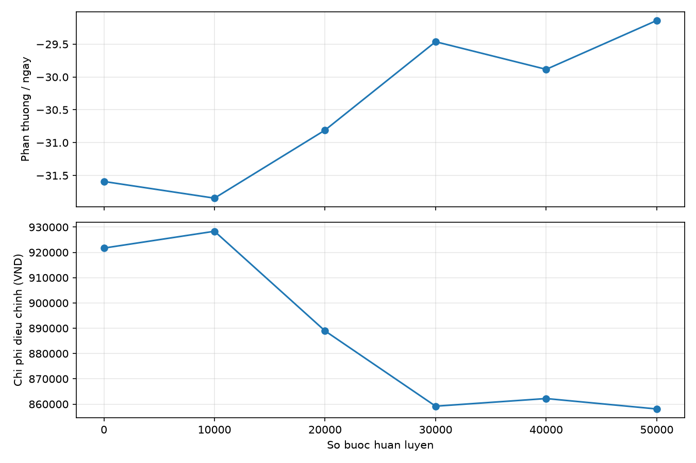

# Báo cáo chạy thử SAC của Nguyễn Văn Trường

Ngày kiểm tra: 23/11/2026. Phần việc đã triển khai gồm SAC tự viết bằng PyTorch, bản SB3 làm tham chiếu, công cụ huấn luyện/đánh giá và kiểm thử. Hai bản đã chạy 50.000 bước với seed 0 trên môi trường sẵn có của nhóm.

Kết quả cho thấy bản tự viết học được cách giảm tiền điện trên validation, nhưng còn hao mòn và nhiều lệnh bị bộ lọc an toàn điều chỉnh. Khi tính tổng chi phí có điều chỉnh tồn kho pin, bản tự viết chưa tốt hơn bộ điều khiển theo luật. Đây là kết quả chạy thử một seed, chưa phải kết luận cuối cùng trên test.

## Điều kiện thực nghiệm

| Nội dung | Giá trị |
| --- | --- |
| Dữ liệu | CSV tổng hợp hiện có, 365 ngày, mỗi ngày 96 bước |
| Phân chia | Train 255 ngày, validation 54 ngày, test 56 ngày |
| Ngân sách | 50.000 bước mỗi bản; 5.000 bước thăm dò ban đầu |
| Mạng | Hai lớp ẩn 256 nút, ReLU; Actor Gaussian–tanh, hai Critic, hai Critic đích |
| Cấu hình | Learning rate 0,0003; gamma 0,99; tau 0,005; batch 256; buffer 200.000 |
| Entropy | Alpha tự điều chỉnh, khởi tạo 1; entropy mục tiêu -1 |
| Điều kiện đánh giá | SoC đầu 0,5; hành động tất định; mốc No-battery của cùng ngày |
| Chọn mô hình | Chi phí tổng hợp có điều chỉnh tồn kho trung bình trên validation thấp nhất |
| Checkpoint đã chọn | SAC tự viết: bước 50.000; SB3: bước 40.000 |
| Tập dùng cho bảng dưới | Validation; chưa chạy đánh giá hiệu năng trên test |

Các trọng số thưởng và thông số pin giữ nguyên theo cấu hình gốc. Điều chỉnh cuối ngày, kịch bản và phép đo được đóng gói trong wrapper của công cụ SAC. Dương cần dùng cùng quy ước khi so sánh các thuật toán khác.

## Kết quả trên toàn bộ 54 ngày validation

Đơn vị chi phí là VNĐ/ngày; các ô là trung bình 54 ngày. Chi phí điều chỉnh cộng giá trị quy ước của lượng điện pin đã sử dụng ròng, hoặc trừ giá trị lượng điện tích thêm. Chi phí tổng hợp còn cộng hao mòn và các thành phần phạt trong hàm thưởng.

| Phương pháp | Tiền điện gốc | Tiền điện có điều chỉnh tồn kho | Tổng chi phí có điều chỉnh |
| --- | ---: | ---: | ---: |
| No-battery | 861.399 | 861.399 | 861.399 |
| Theo luật | 741.361 | 728.222 | 850.047 |
| SAC tự viết | 620.973 | 722.525 | 858.078 |
| SAC SB3 | 616.993 | 702.773 | 844.537 |

Tiền điện gốc của SAC tự viết thấp hơn No-battery khoảng 27,91% nếu tính từ tổng tiền trên cả tập validation. Tuy nhiên, hao mòn trung bình là 135.489 VNĐ/ngày và khoản điều chỉnh tồn kho là khoảng 101.552 VNĐ/ngày. Vì vậy mức cải thiện tổng chi phí có điều chỉnh so với No-battery chỉ khoảng 0,39% trong lần chạy này.

SoC cuối ngày của SAC tự viết đều ở mức 20%; số bước lệnh bị cắt trung bình là 33,57/96. Mô hình vẫn phụ thuộc nhiều vào bộ lọc an toàn. Cần phân tích hành vi này trước khi coi mô hình đã điều khiển tốt toàn diện.

## Kết quả theo kịch bản

Bảng dưới là trung bình phần trăm tiết kiệm tiền điện **sau điều chỉnh tồn kho**, chưa cộng hao mòn. Mỗi ngày được so với No-battery của chính ngày đó. Đây là trung bình các tỷ lệ từng ngày, khác với tỷ lệ tính từ tổng tiền cả tập.

| Kịch bản | Số ngày | SAC tự viết | SAC SB3 | Theo luật |
| --- | ---: | ---: | ---: | ---: |
| S1 ngày làm việc | 46 | 21,16% | 23,35% | 17,43% |
| S2 chủ nhật | 8 | -4,02% | 3,49% | 9,31% |
| S3 PV còn 50% | 54 | 0,12% | 1,01% | 8,47% |
| S4 nhiễu quan sát | 54 | 14,89% | 17,21% | 14,63% |
| S5 nguyên dữ liệu toàn tập | 54 | 17,43% | 20,41% | 16,22% |

SAC tự viết hoạt động yếu trên chủ nhật và khi PV giảm. Nhiễu quan sát cũng làm giảm hiệu quả so với S5. Những trường hợp này là cơ sở để chẩn đoán và thiết kế thí nghiệm tiếp theo, không phải lý do loại ngày bất lợi khỏi bảng so sánh.

Dữ liệu đầy đủ của bảng nằm trong [metrics.csv](sac_pilot/metrics.csv). Các kịch bản có ngày trùng nhau; không cộng số ngày của S1–S5 để coi đó là các ngày lịch độc lập.

## Biểu đồ

Phần thưởng validation tăng nhìn chung từ -31,59 lên -29,14, nhưng có dao động tại bước 40.000. Chi phí tổng hợp điều chỉnh giảm từ khoảng 921.706 xuống 858.078 VNĐ/ngày. Đường cong này không chứng minh mô hình đã hội tụ.

- [Đường cong bản SB3](sac_pilot/learning_sb3.png).
- [Biểu đồ đối chiếu tiền điện điều chỉnh cho S1–S5](sac_pilot/comparison.png).
- [Hành vi pin trong một ngày minh họa của SAC tự viết](sac_pilot/example_day.png).

## Kiểm tra đã thực hiện

- 17 kiểm thử SAC và quy trình chạy bằng dòng lệnh đều đạt. Các kiểm tra gồm log xác suất sau tanh, gradient, mục tiêu Bellman, buffer, mạng đích, lưu/nạp, kịch bản, điều chỉnh tồn kho, tổng hợp seed và bảo vệ kết quả cũ.
- 8 kiểm thử môi trường gốc đều đạt. Gymnasium có cảnh báo về chế độ render chưa đăng ký spec; các kiểm tra giao diện/động lực học vẫn đạt.
- SAC tự viết và SB3 đều hoàn thành 50.000 bước; log không ghi nhận lỗi giá trị không hữu hạn.
- Mô hình đã lưu được nạp lại để đánh giá S1–S5, xuất 864 bản ghi KPI theo tổ hợp phương pháp/kịch bản/ngày và các biểu đồ.
- Kiểm tra phụ thuộc Python không phát hiện xung đột.

Thông tin cấu hình, phiên bản và hash dữ liệu được giữ trong [run_info.json](sac_pilot/run_info.json). Mô hình và log gốc nằm ở `runs/sac_pilot/`, được `.gitignore` loại khỏi Git; cần chuyển kèm chúng nếu Dương muốn chạy lại suy luận.

## Những điểm cần Dương lưu ý

1. Dùng cùng wrapper xử lý quan sát cuối ngày và biên phân vùng. Không lấy dữ liệu validation/test để làm trạng thái kế tiếp cho ngày train cuối.
2. Giữ tiền điện gốc và tiền điện điều chỉnh thành hai chỉ số riêng. Giá trị tồn kho dùng giá mua trung bình của train và hiệu suất xả; đây là giả định định giá, không phải hóa đơn thực tế.
3. Tiêu chí chọn checkpoint có thêm điều chỉnh tồn kho, trong khi hàm thưởng huấn luyện giữ nguyên. Cần ghi rõ sự khác biệt này.
4. S4 chỉ làm nhiễu quan sát, không thay đổi tải/PV vật lý. S3 trong công cụ SAC thực sự giảm PV, khác việc API hiện tại chỉ chọn một ngày cố định.
5. No-battery của dữ liệu gốc không vượt ngưỡng 90 kW. Cần một thí nghiệm có tải/ngưỡng phù hợp nếu muốn kết luận về xử lý vượt đỉnh.
6. Một seed chưa cho phép kết luận độ ổn định. Cột độ lệch chuẩn giữa seed bằng 0 trong lần chạy này chỉ vì có một seed.
7. Chỉ số tự tiêu thụ PV kế thừa chưa truy vết nguồn điện trong pin; cần thận trọng khi pin có thể xuất điện lên lưới.

## Công việc tiếp theo

Ưu tiên chẩn đoán hành vi ở S2/S3 và số lệnh bị cắt. Có thể kiểm tra thêm tác động của định giá pin cuối ngày vào mục tiêu huấn luyện, trọng số phạt và ngân sách học; mỗi thay đổi phải lưu thành cấu hình mới và so sánh công bằng trên validation.

Sau khi chốt cấu hình, chạy 300.000 bước với 5 seed theo kế hoạch của nhóm, tổng hợp trung bình và độ lệch chuẩn giữa seed, rồi đánh giá trên test. Kết quả hiện tại chưa thay thế giai đoạn thực nghiệm chính thức này.

Hướng dẫn đọc mã, các công thức và cách bàn giao giao diện `predict` nằm trong [SAC của Nguyễn Văn Trường](SAC_NGUYEN_VAN_TRUONG.md).
