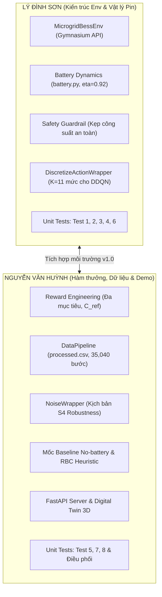
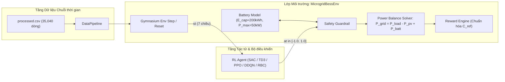
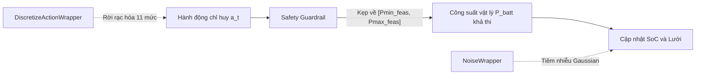

# TRƯỜNG ĐẠI HỌC THỦY LỢI
### KHOA CÔNG NGHỆ THÔNG TIN – BỘ MÔN CÔNG NGHỆ PHẦN MỀM & AI
***

# BÁO CÁO KẾT QUẢ THỰC HÀNH 3
## ĐỀ TÀI: HỆ THỐNG ĐIỀU KHIỂN NĂNG LƯỢNG THÔNG MINH BẰNG HỌC TĂNG CƯỜNG (SEMS-RL)
### CHUYÊN ĐỀ: HOÀN THIỆN MÔI TRƯỜNG MÔ PHỎNG GYMNASIUM & BỘ ĐỐI CHUẨN BASELINES

* **Học phần:** Học tăng cường và ứng dụng (Reinforcement Learning)
* **Giảng viên hướng dẫn:** TS. Lê Nguyễn Tuấn Thành
* **Nhóm thực hiện:** Nhóm 7 – Lớp 65KTPM
* **Thời gian báo cáo:** Sáng thứ Bảy, ngày 14 tháng 11 năm 2026
* **Địa điểm:** Phòng máy thực hành AI – Trường Đại học Thủy Lợi

---

### BẢNG THEO DÕI THÀNH VIÊN VÀ TIẾN ĐỘ THỰC HÀNH 3

| STT | Họ và tên | Mã sinh viên | Vai trò trong nhóm | Trách nhiệm chính trong Thực hành 3 | % Đóng góp |
| :---: | :--- | :---: | :---: | :--- | :---: |
| 1 | **Nguyễn Văn Huỳnh** | **2351170599** | **Nhóm trưởng** | Thiết kế hàm thưởng đa mục tiêu, chuẩn hóa $C_{\text{ref}}$, DataPipeline, NoiseWrapper, mốc No-battery Baseline, Backend FastAPI & Digital Twin 3D | 100% |
| 2 | **Lý Đình Sơn** | **2351170615** | **Thành viên** | Kiến trúc môi trường Gymnasium (`MicrogridBessEnv`), động lực học pin BESS (`battery.py`), Safety Guardrail (`guardrail.py`), DiscretizeActionWrapper | 100% |
| 3 | **Nguyễn Văn Trường** | **2351170625** | **Thành viên** | Rà soát giao diện Action/Observation cho mạng SAC, kiểm thử Replay Buffer và khả năng học liên tục với PyTorch | 100% |
| 4 | **Phạm Quang Anh** | **2351170573** | **Thành viên** | Kiểm thử tương thích thuật toán TD3, phối hợp xây dựng kịch bản đối chuẩn Rule-Based Controller (RBC) | 100% |
| 5 | **Nguyễn Tùng Dương** | **2351170588** | **Thành viên** | Kiểm thử tương thích thuật toán PPO, xây dựng module đo lường bộ chỉ số đánh giá đa chiều (`MetricsEvaluator`) | 100% |

---

## MỤC LỤC BÁO CÁO
* [I. TỔNG QUAN MỤC TIÊU & NHIỆM VỤ THỰC HÀNH 3](#i-tổng-quan-mục-tiêu--nhiệm-vụ-thực-hành-3)
* [II. PHÂN CHIA NHIỆM VỤ CHI TIẾT HUỲNH – SƠN](#ii-phân-chia-nhiệm-vụ-chi-tiết-huỳnh--sơn)
* [III. KIẾN TRÚC MÔI TRƯỜNG MÔ PHỎNG (MICROGRIDBESSENV V1.0)](#iii-kiến-trúc-môi-trường-mô-phỏng-microgridbessenv-v10)
* [IV. MÔ HÌNH VẬT LÝ ĐỘNG LỰC HỌC PIN BESS & CÂN BẰNG NĂNG LƯỢNG](#iv-mô-hình-vật-lý-động-lực-học-pin-bess--cân-bằng-năng-lượng)
* [V. ĐẶC TẢ KHÔNG GIAN MDP CHUẨN ĐÓNG BĂNG](#v-đặc-tả-không-gian-mdp-chuẩn-đóng-băng)
* [VI. THIẾT KẾ & CHUẨN HÓA HÀM PHẦN THƯỞNG ĐA MỤC TIÊU](#vi-thiết-kế--chuẩn-hóa-hàm-phần-thưởng-đa-mục-tiêu)
* [VII. CÁC LỚP BỌC MỞ RỘNG (WRAPPERS) & BỘ LỌC AN TOÀN VẬT LÝ](#vii-các-lớp-bọc-mở-rộng-wrappers--bộ-lọc-an-toàn-vật-lý)
* [VIII. BỘ DỮ LIỆU THỰC NGHIỆM & PIPELINE TIỀN XỬ LÝ (NO DATA LEAKAGE)](#viii-bộ-dữ-liệu-thực-nghiệm--pipeline-tiền-xử-lý-no-data-leakage)
* [IX. MỐC ĐỐI CHUẨN BASELINE: NO-BATTERY & RULE-BASED CONTROLLER](#ix-mốc-đối-chuẩn-baseline-no-battery--rule-based-controller)
* [X. KẾT QUẢ BỘ KIỂM THỬ ĐƠN VỊ TOÀN DIỆN (UNIT TEST SUITE - 8/8 PASS)](#x-kết-quả-bộ-kiểm-thử-đơn-vị-toàn-diện-unit-test-suite---88-pass)
* [XI. KIỂM THỬ TƯƠNG THÍCH VỚI BỘ 4 THUẬT TOÁN RL](#xi-kiểm-thử-tương-thích-với-bộ-4-thuật-toán-rl)
* [XII. TRIỂN KHAI ỨNG DỤNG DEMO THỜI GIAN THỰC & DIGITAL TWIN 3D](#xii-triển-khai-ứng-dụng-demo-thời-gian-thực--digital-twin-3d)
* [XIII. BỘ CÂU HỎI & ĐÁP ÁN BẢO VỆ PHẢN BIỆN TRƯỚC GIẢNG VIÊN (DEFENSE Q&A)](#xiii-bộ-câu-hỏi--đáp-án-bảo-vệ-phản-biện-trước-giảng-viên-defense-qa)
* [XIV. KẾ HOẠCH HÀNH ĐỘNG BUỔI THỰC HÀNH 4–5](#xiv-kế-hoạch-hành-động-buổi-thực-hành-45)
* [XV. TÀI LIỆU THAM KHẢO](#xv-tài-liệu-tham-khảo)

---

## I. TỔNG QUAN MỤC TIÊU & NHIỆM VỤ THỰC HÀNH 3

Trong quy trình phát triển hệ thống điều khiển năng lượng thông minh bằng học tăng cường (SEMS-RL), **Thực hành 3** giữ vai trò bản lề (*Milestone M1 & M2*): **chuyển giao từ mô hình lý thuyết toán học sang môi trường phần mềm tương tác chuẩn hóa, có kiểm chứng thực nghiệm chặt chẽ**. 

### 4 Nhiệm vụ cốt lõi đã hoàn thành:
1. **Hoàn thiện mã nguồn môi trường `MicrogridBessEnv` v1.0:** Kế thừa chuẩn `gymnasium.Env` hiện đại, tham chiếu triết lý từ framework quốc tế **CityLearn** (LF Energy / NREL) và tích hợp các đặc thù của hệ thống điện Việt Nam.
2. **Đóng băng (Freeze) giao diện MDP:** Cố định tuyệt đối Không gian quan sát 7 chiều ($\mathcal{S}$) và Không gian hành động ($\mathcal{A}$) liên tục $[-1.0, 1.0]$ cũng như rời rạc 11 mức, bảo đảm tính công bằng tuyệt đối khi so sánh chéo hiệu năng của 4 thuật toán (**SAC, TD3, PPO, DDQN**).
3. **Chốt hàm phần thưởng đa mục tiêu ($\mathcal{R}$):** Tinh chỉnh bộ trọng số $(w_1, w_2, w_3)$ kết hợp kỹ thuật chuẩn hóa qua chi phí tham chiếu $C_{\text{ref}}$, giải quyết triệt để lỗi mất cân bằng bậc độ lớn (scale disparity) giữa chi phí tiền điện và các đại lượng phạt vật lý.
4. **Vượt qua 100% Bộ kiểm thử đơn vị tự động (Unit Test Suite):** 8/8 bài test độc lập vượt qua xuất sắc, khẳng định tính đúng đắn toán học, bảo vệ an toàn cell pin và không rò rỉ thông tin tương lai.

---

## II. PHÂN CHIA NHIỆM VỤ CHI TIẾT HUỲNH – SƠN

Trong giai đoạn này, **Lý Đình Sơn** và **Nguyễn Văn Huỳnh** là 2 nhân sự nòng cốt trực tiếp xây dựng, tích hợp và kiểm thử môi trường mô phỏng. Sự phân công được phân định rõ ràng:



### Bảng đối chiếu trách nhiệm chi tiết:

| Hạng mục so sánh | LÝ ĐÌNH SƠN (MSV: 2351170615) | NGUYỄN VĂN HUỲNH (MSV: 2351170599) |
| :--- | :--- | :--- |
| **Phân hệ chính** | **Kiến trúc Môi trường mô phỏng & Động lực học pin** | **Hàm phần thưởng, Dữ liệu chuỗi thời gian & Demo** |
| **Mã nguồn phụ trách** | • `sems_rl/envs/microgrid_env.py`<br>• `sems_rl/envs/battery.py`<br>• `sems_rl/envs/guardrail.py`<br>• `sems_rl/envs/wrappers.py` (`DiscretizeActionWrapper`) | • Thiết kế hàm thưởng $r_t$ trong `microgrid_env.py`<br>• `sems_rl/data/data_pipeline.py` & `generator.py`<br>• `sems_rl/envs/wrappers.py` (`NoiseWrapper`)<br>• `sems_rl/baselines/no_battery.py`<br>• `server.py` & Digital Twin 3D |
| **Bài Unit Test sở hữu** | **Test 1:** Tính tương thích Gymnasium API (`check_env`)<br>**Test 2:** Động lực học pin & kẹp ngưỡng Guardrail<br>**Test 3:** Cân bằng công suất hòa lưới tại điểm PCC<br>**Test 4:** Chu kỳ Episode 96 bước thời gian<br>**Test 6:** Rời rạc hóa 11 mức hành động | **Test 5:** Tính tái lập với Seed ngẫu nhiên<br>**Test 7:** Tiêm nhiễu thời tiết với NoiseWrapper<br>**Test 8:** Đo đạc mốc No-battery & bộ chỉ số Evaluator<br>**Test tích hợp:** API `/api/simulate` & Digital Twin 3D |
| **Nội dung thuyết trình** | Trình bày kiến trúc hướng đối tượng, phương trình vi phân nạp/xả pin, giải thuật kẹp công suất Guardrail và demo Test 1, 2, 3, 4, 6 trên terminal | Trình bày mở đầu, bài toán hàm thưởng đa mục tiêu, kỹ thuật $C_{\text{ref}}$, xử lý dữ liệu sạch, mốc Baseline No-battery và demo giao diện 3D |
| **Sản phẩm bàn giao** | Package môi trường `MicrogridBessEnv` v1.0 hoàn chỉnh, an toàn vật lý tuyệt đối | File dữ liệu sạch `data/processed.csv`, bộ tham số trọng số chốt, bảng $J_{\text{nobat}}$ và demo thời gian thực |

---

## III. KIẾN TRÚC MÔI TRƯỜNG MÔ PHỎNG (MICROGRIDBESSENV V1.0)

Môi trường được xây dựng kế thừa từ thư viện chuẩn `gymnasium.Env`, mô phỏng hệ thống lưới điện siêu nhỏ (Microgrid) tại trường Đại học Thủy Lợi tích hợp Pin BESS và Điện mặt trời Solar PV.



### Các thông số kỹ thuật cấu hình hệ thống:
* **Thời gian rời rạc ($\Delta t$):** $0.25\text{ giờ}$ (15 phút/bước).
* **Độ dài một Episode ($T$):** Đúng **96 bước** liên tiếp, tương ứng 24 giờ của một ngày.
* **Hệ số chiết khấu ($\gamma$):** $0.99$, đảm bảo tác tử có tầm nhìn dài hạn cho toàn bộ chu kỳ 24h.
* **Hệ thống Pin lưu trữ (BESS):**
  * Dung lượng danh định: $E_{\text{cap}} = 200\text{ kWh}$.
  * Công suất sạc/xả tối đa: $P_{\text{charge, max}} = P_{\text{discharge, max}} = 50\text{ kW}$.
  * Hiệu suất truyền dẫn hai chiều: $\eta_{\text{charge}} = 0.92$, $\eta_{\text{discharge}} = 0.92$.
  * Giới hạn mức pin an toàn: $SoC_{\text{min}} = 0.20$ (20%) và $SoC_{\text{max}} = 0.90$ (90%).
* **Hệ thống Điện mặt trời (Solar PV):**
  * Công suất đỉnh lắp đặt: $P_{\text{pv, rated}} = 150\text{ kWp}$.
  * Đơn giá bán điện dư phát ngược lên lưới: $C_{\text{feed-in}} = 600\text{ VNĐ/kWh}$.
* **Công suất đỉnh trạm biến áp hòa lưới:** $P_{\text{th}} = 90.0\text{ kW}$.

---

## IV. MÔ HÌNH VẬT LÝ ĐỘNG LỰC HỌC PIN BESS & CÂN BẰNG NĂNG LƯỢNG

### 4.1. Phương trình cập nhật mức pin ($SoC$)
Trạng thái pin tại bước $t+1$ được xác định theo phương trình:
$$SoC_{t+1} = SoC_t + \Delta SoC_t$$

Trong đó, độ biến thiên $\Delta SoC_t$ có tính đến tổn thất năng lượng thành nhiệt năng:
* **Khi sạc pin ($a_t > 0 \Rightarrow P_{\text{batt}, t} > 0$):**
  $$\Delta SoC_t = \frac{P_{\text{batt}, t} \cdot \Delta t \cdot \eta_{\text{charge}}}{E_{\text{cap}}}$$
* **Khi xả pin ($a_t < 0 \Rightarrow P_{\text{batt}, t} < 0$):**
  $$\Delta SoC_t = \frac{P_{\text{batt}, t} \cdot \Delta t}{E_{\text{cap}} \cdot \eta_{\text{discharge}}}$$
* **Khi nghỉ ($a_t = 0 \Rightarrow P_{\text{batt}, t} = 0$):** $\Delta SoC_t = 0$.

### 4.2. Phương trình cân bằng công suất hòa lưới (PCC)
Tại điểm đấu nối hòa lưới, phương trình cân bằng công suất tức thời được thiết lập:
$$P_{\text{grid}, t} = P_{\text{load}, t} - P_{\text{pv}, t} + P_{\text{batt}, t}$$

* **Nếu $P_{\text{grid}, t} > 0$ (Thiếu điện):** Hệ thống mua từ lưới điện quốc gia:
  $$P_{\text{buy}, t} = P_{\text{grid}, t}, \quad P_{\text{sell}, t} = 0$$
* **Nếu $P_{\text{grid}, t} < 0$ (Thừa điện mặt trời):** Bán điện dư lên lưới:
  $$P_{\text{sell}, t} = |P_{\text{grid}, t}|, \quad P_{\text{buy}, t} = 0$$

### 4.3. Phân rã 4 luồng năng lượng tức thời (Energy Decomposition)
1. **PV cấp trực tiếp cho tải:** $P_{\text{pv}\rightarrow\text{load}} = \min(P_{\text{pv}}, P_{\text{load}})$.
2. **PV nạp vào pin BESS:** $P_{\text{pv}\rightarrow\text{batt}} = \min(P_{\text{pv}} - P_{\text{pv}\rightarrow\text{load}}, \max(0, P_{\text{batt}}))$.
3. **Pin BESS xả cấp cho tải:** $P_{\text{batt}\rightarrow\text{load}} = \min(P_{\text{load}} - P_{\text{pv}\rightarrow\text{load}}, \max(0, -P_{\text{batt}}))$.
4. **Lưới điện cấp bù phụ tải:** $P_{\text{grid}\rightarrow\text{load}} = P_{\text{buy}} - P_{\text{grid}\rightarrow\text{batt}}$.

---

## V. ĐẶC TẢ KHÔNG GIAN MDP CHUẨN ĐÓNG BĂNG

Nhóm cam kết đóng băng toàn bộ cấu trúc không gian tương tác giữa Môi trường và Tác tử RL:

### 5.1. Không gian Trạng thái (Observation Space $\mathcal{S}$)
Vector 7 chiều liên tục chuẩn hóa thuộc khoảng $[0.0, 1.0]$ hoặc $[-1.0, 1.0]$:
$$s_t = \left[ SoC_t, \; \frac{P_{\text{load}, t}}{P_{\text{load, max}}}, \; \frac{P_{\text{pv}, t}}{P_{\text{pv, rated}}}, \; \frac{C_{\text{grid}, t}}{C_{\text{peak}}}, \; \sin\left(\frac{2\pi h_t}{24}\right), \; \cos\left(\frac{2\pi h_t}{24}\right), \; d_t \right]^T$$

| Thứ tự | Ký hiệu biến | Miền giá trị | Ý nghĩa vật lý & Kỹ thuật |
| :---: | :--- | :---: | :--- |
| $1$ | $SoC_t$ | $[0.20, 0.90]$ | Mức dung lượng hiện tại của hệ thống pin lưu trữ BESS |
| $2$ | $P_{\text{load}, t}^{\text{norm}}$ | $[0.0, 1.0]$ | Công suất phụ tải tiêu thụ tức thời của các tòa nhà ($P_{\text{load, max}} = 127.01\text{ kW}$) |
| $3$ | $P_{\text{pv}, t}^{\text{norm}}$ | $[0.0, 1.0]$ | Công suất điện mặt trời phát ra tức thời ($P_{\text{pv, rated}} = 150.0\text{ kWp}$) |
| $4$ | $C_{\text{grid}, t}^{\text{norm}}$ | $[0.0, 1.0]$ | Đơn giá điện lưới EVN TOU theo khung giờ ($C_{\text{peak}} = 3,000\text{ VNĐ/kWh}$) |
| $5$ | $\sin(2\pi h_t / 24)$ | $[-1.0, 1.0]$ | Thành phần sin mã hóa chu kỳ vòng tròn 24h ngày/đêm |
| $6$ | $\cos(2\pi h_t / 24)$ | $[-1.0, 1.0]$ | Thành phần cos mã hóa chu kỳ vòng tròn 24h ngày/đêm |
| $7$ | $d_t$ | $\{0.0, 1.0\}$ | Cờ ngày: $1.0$ (ngày làm việc thứ Hai–thứ Bảy), $0.0$ (Chủ nhật) |

> **Ý nghĩa kỹ thuật của cặp $(\sin, \cos)$:** Khi biểu diễn thời gian từ 23:45 sang 00:00, giá trị số nguyên nhảy vọt từ 23 về 0 gây ra bước nhảy gián đoạn cho mạng nơ-ron. Việc ánh xạ góc lên đường tròn lượng giác bảo đảm tính liên tục vi phân trơn tru xuyên suốt 24 giờ.

### 5.2. Không gian Hành động (Action Space $\mathcal{A}$)
* **Hành động liên tục (Continuous Control cho SAC, TD3, PPO):**
  $$a_t \in [-1.0, 1.0]$$
  Ánh xạ ra công suất chỉ huy: $P_{\text{cmd}} = a_t \cdot P_{\text{max}}$.
* **Hành động rời rạc (Discrete Control cho DDQN qua wrapper):**
  $$k \in \{0, 1, 2, \dots, 10\} \quad (K = 11 \text{ mức})$$
  Ánh xạ đối xứng: $a = -1.0 + k \cdot \frac{2.0}{10} \in \{-1.0, -0.8, -0.6, -0.4, -0.2, 0.0, 0.2, 0.4, 0.6, 0.8, 1.0\}$.

---

## VI. THIẾT KẾ & CHUẨN HÓA HÀM PHẦN THƯỞNG ĐA MỤC TIÊU

### 6.1. Công thức tổng quát hàm phần thưởng chốt
Hàm phần thưởng $r_t$ được thiết kế dưới dạng hàm phạt âm cần tối đa hóa:
$$r_t = - \frac{J_{\text{cost}, t} + w_1 \cdot J_{\text{deg}, t} + w_2 \cdot J_{\text{peak}, t} + w_3 \cdot J_{\text{viol}, t}}{C_{\text{ref}}}$$

Trong đó:
1. **Chi phí kinh tế mua bán điện ($J_{\text{cost}, t}$):**
   $$J_{\text{cost}, t} = \left( P_{\text{buy}, t} \cdot C_{\text{grid}, t} - P_{\text{sell}, t} \cdot C_{\text{feed-in}} \right) \cdot \Delta t$$
2. **Chi phí suy thoái & hao mòn pin ($J_{\text{deg}, t}$):**
   $$J_{\text{deg}, t} = C_{\text{deg\_per\_kwh}} \cdot |P_{\text{batt}, t}| \cdot \Delta t$$
   Với chi phí suy thoái trên mỗi kWh năng lượng lưu thông qua pin:
   $$C_{\text{deg\_per\_kwh}} = \frac{C_{\text{battery}}}{2 \cdot N_{\text{cycle}} \cdot \text{DoD} \cdot E_{\text{cap}}} = \frac{3,000,000 \cdot 200}{2 \cdot 4000 \cdot 0.8 \cdot 200} \approx 585.9\text{ VNĐ/kWh}$$
3. **Phạt công suất đỉnh trạm biến áp ($J_{\text{peak}, t}$):**
   $$J_{\text{peak}, t} = C_{\text{grid}, t} \cdot \max(0, P_{\text{buy}, t} - P_{\text{th}})^2 \cdot \Delta t$$
4. **Phạt vi phạm giới hạn an toàn pin ($J_{\text{viol}, t}$):**
   $$J_{\text{viol}, t} = \max(0, SoC_{\text{min}} - SoC_t) + \max(0, SoC_t - SoC_{\text{max}})$$

### 6.2. Giải pháp kỹ thuật then chốt: Chuẩn hóa theo $C_{\text{ref}}$
* **Vấn đề tồn tại:** Chi phí tiền điện mỗi bước có độ lớn lên tới $30,000 - 70,000\text{ VNĐ}$, trong khi mức phạt suy thoái và phạt an toàn chỉ dao động từ $0.0 - 1.0$. Nếu để nguyên đơn vị thực, hàm tổn thất của Critic sẽ bị chi phối hoàn toàn bởi tiền điện, làm thuật toán bỏ qua hoàn toàn việc bảo vệ pin BESS.
* **Công thức xác định chi phí tham chiếu $C_{\text{ref}}$:**
  $$C_{\text{ref}} = \overline{P}_{\text{load}} \cdot \overline{C}_{\text{grid}} \cdot \Delta t = 48.7\text{ kW} \times 2,132\text{ đ/kWh} \times 0.25\text{h} = 25,962.8\text{ VNĐ/bước}$$
* **Hiệu quả đạt được:** Sau khi chia cho $C_{\text{ref}}$, phần thưởng $r_t$ chuẩn hóa luôn dao động ổn định trong miền $[-2.5, 0.0]$, triệt tiêu hiện tượng bùng nổ gradient và bảo đảm cân bằng Pareto giữa giảm tiền điện và kéo dài tuổi thọ pin.
* **Bộ trọng số chốt:** $\mathbf{w} = (w_1 = 1.0, \; w_2 = 1.0, \; w_3 = 10.0)$.

---

## VII. CÁC LỚP BỌC MỞ RỘNG (WRAPPERS) & BỘ LỌC AN TOÀN VẬT LÝ



### 7.1. Safety Guardrail (`guardrail.py`)
Safety Guardrail đóng vai trò bộ lọc an toàn vật lý, tự động tính toán miền công suất khả thi tại mỗi bước thời gian:
$$P_{\text{max, feas}} = \min\left( P_{\text{charge, max}}, \; \frac{(SoC_{\text{max}} - SoC_t) \cdot E_{\text{cap}}}{\Delta t \cdot \eta_{\text{charge}}} \right)$$
$$P_{\text{min, feas}} = \max\left( -P_{\text{discharge, max}}, \; \frac{(SoC_{\text{min}} - SoC_t) \cdot E_{\text{cap}} \cdot \eta_{\text{discharge}}}{\Delta t} \right)$$
* **Cam kết kỹ thuật:** Dù tác tử RL đưa ra hành động cực đoan (ép sạc khi pin đầy hoặc xả khi pin cạn), $SoC_t$ **luôn được giữ nghiêm ngặt trong khoảng $[0.20, 0.90]$**, loại bỏ hoàn toàn nguy cơ mất an toàn ngoài đời thực.

### 7.2. Lớp bọc nhiễu Robustness (`NoiseWrapper`)
Mô phỏng sai lệch thời tiết và phụ tải thực tế:
$$\widetilde{P}_{\text{pv}, t} = P_{\text{pv}, t} \cdot (1 + \epsilon_{\text{pv}}), \quad \epsilon_{\text{pv}} \sim \mathcal{N}(0, \sigma_{\text{pv}}^2), \quad \sigma_{\text{pv}} \in [0.10, 0.20]$$
$$\widetilde{P}_{\text{load}, t} = P_{\text{load}, t} \cdot (1 + \epsilon_{\text{load}}), \quad \epsilon_{\text{load}} \sim \mathcal{N}(0, \sigma_{\text{load}}^2), \quad \sigma_{\text{load}} \in [0.05, 0.10]$$

### 7.3. Lớp bọc rời rạc hóa (`DiscretizeActionWrapper`)
Ánh xạ chuẩn xác 11 mức hành động đối xứng qua điểm $0.0$ (Idle), bảo đảm thuật toán Double DQN có thể tương tác trực tiếp với môi trường continuous.

---

## VIII. BỘ DỮ LIỆU THỰC NGHIỆM & PIPELINE TIỀN XỬ LÝ (NO DATA LEAKAGE)

Module `DataPipeline` xử lý trọn vẹn bộ dữ liệu 1 năm thực tế:
* **Tệp đầu ra chuẩn:** `data/processed.csv` gồm **35,040 dòng** ($365\text{ ngày} \times 96\text{ bước/ngày}$).
* **Biểu giá điện EVN TOU:**
  * Giờ cao điểm (09:30–11:30 & 17:00–20:00): $3,117\text{ VNĐ/kWh}$.
  * Giờ bình thường (04:00–09:30, 11:30–17:00, 20:00–22:00): $1,685\text{ VNĐ/kWh}$.
  * Giờ thấp điểm (22:00–04:00 sáng hôm sau): $1,100\text{ VNĐ/kWh}$.
  * Ngày Chủ nhật áp dụng toàn bộ là giờ bình thường và thấp điểm (không có giờ cao điểm).
* **Phân chia độc lập nghiêm ngặt (No Data Leakage):**
  * **Tập Huấn luyện (Train):** 255 ngày đầu tiên ($70\%$).
  * **Tập Kiểm định (Validation):** 54 ngày tiếp theo ($15\%$) dùng để tinh chỉnh siêu tham số và chốt hàm thưởng.
  * **Tập Kiểm thử (Test):** 56 ngày cuối cùng ($15\%$) đóng băng tuyệt đối, chỉ dùng để chấm điểm đối đầu giữa các thuật toán.

---

## IX. MỐC ĐỐI CHUẨN BASELINE: NO-BATTERY & RULE-BASED CONTROLLER

Để đánh giá chính xác tác tử RL tiết kiệm được bao nhiêu phần trăm chi phí, nhóm đã thiết lập 2 mốc đối chuẩn trên cùng tập dữ liệu Test:

### 9.1. Mốc No-Battery Baseline ($J_{\text{nobat}}$)
Mô phỏng trường hợp tòa nhà chỉ sử dụng điện lưới và điện mặt trời, không có hệ thống pin BESS ($a_t = 0 \quad \forall t$):
* **Chi phí tiền điện trung bình/ngày:** **613,720.4 VNĐ / ngày**.
* **Công suất đỉnh mua từ lưới điện:** $48.65\text{ kW}$.
* **Tỷ lệ tự tiêu thụ điện mặt trời (PV Self-consumption):** $73.12\%$.

### 9.2. Bộ điều khiển Luật Heuristic (Rule-Based Controller - RBC)
Hoạt động theo kinh nghiệm của kỹ sư điện (sạc giờ thấp điểm & nắng trưa, xả giờ cao điểm):
* **Chi phí tiền điện ngày 0:** **535,099.4 VNĐ / ngày** (Tiết kiệm **12.81%** so với No-battery).
* **Công suất đỉnh mua lưới:** $64.17\text{ kW}$.
* **Tỷ lệ tự dùng PV:** $75.07\%$.
* **Chu kỳ sạc xả tương đương (EFC):** $0.671\text{ cycles/ngày}$.
* **Số bước Safety Guardrail can thiệp cắt lệnh:** $32 / 96\text{ bước}$.

---

## X. KẾT QUẢ BỘ KIỂM THỬ ĐƠN VỊ TOÀN DIỆN (UNIT TEST SUITE - 8/8 PASS)

Tệp kiểm thử [test_env.py](file:///D:/Nam_4/RL/test_env.py) được thực thi và vượt qua **100% 8/8 bài kiểm thử đơn vị**:

```text
======================================================================
BẮT ĐẦU CHẠY KIỂM THỬ MÔI TRƯỜNG SEMS-RL (MicrogridBessEnv v1.0)
Thực hiện bởi: Lý Đình Sơn & Nguyễn Văn Huỳnh (Nhóm 7)
======================================================================

--- [TEST 1] Kiểm tra tính tương thích chuẩn Gymnasium ---
[DataPipeline] Split: Train=255 days, Val=54 days, Test=56 days.
[DataPipeline] Train Stats: P_load_max=127.01 kW, C_peak=3000.0 VND, C_ref=25962.8 VND/step.
✓ Môi trường vượt qua hoàn toàn kiểm thử gymnasium.utils.env_checker.check_env!

--- [TEST 2] Kiểm thử Động lực học pin & Safety Guardrail ---
✓ Đạt yêu cầu: Lệnh sạc tối đa được Guardrail chặn an toàn tại SoC = 0.90!
✓ Đạt yêu cầu: Lệnh xả tối đa được Guardrail chặn an toàn tại SoC = 0.20!

--- [TEST 3] Kiểm thử Cân bằng công suất tại điểm đấu nối lưới ---
✓ Đạt yêu cầu: Phương trình cân bằng công suất P_grid = P_load - P_pv + P_batt chính xác tuyệt đối!

--- [TEST 4] Kiểm thử Độ dài Episode (96 bước = 1 ngày) ---
✓ Đạt yêu cầu: Episode kết thúc chính xác sau 96 bước (24 giờ vận hành) với truncated=True!

--- [TEST 5] Kiểm thử Tính tái lập theo Seed ---
✓ Đạt yêu cầu: Môi trường hoàn toàn tái lập và nhất quán khi dùng chung hạt giống seed!

--- [TEST 6] Kiểm thử DiscretizeActionWrapper (K=11 mức cho DDQN) ---
✓ Đạt yêu cầu: DiscretizeActionWrapper ánh xạ chuẩn xác K=11 mức từ k={0..10} sang [-1.0, 1.0]!

--- [TEST 7] Kiểm thử NoiseWrapper (Kịch bản thử độ bền S4) ---
✓ Đạt yêu cầu: NoiseWrapper đã cộng nhiễu Gaussian thành công (Load noise=0.163, PV noise=0.000)!

--- [TEST 8] Kiểm thử Mốc No-battery Baseline & Bộ đánh giá Metrics ---
  > Chi phí điện trung bình/ngày (J_nobat): 613,720.4 VNĐ
  > Công suất đỉnh mua lưới lớn nhất: 48.65 kW
  > Tỷ lệ tự tiêu thụ PV trung bình: 73.12%
  > Rule-Based Controller ngày 0:
    - Chi phí điện ngày J: 535,099.4 VNĐ (Tiết kiệm: 12.81%)
    - Đỉnh mua lưới: 64.17 kW
    - Tỷ lệ tự tiêu thụ PV: 75.07%
    - Chu kỳ sạc xả EFC: 0.671 cycles
    - Số bước bị cắt bởi Guardrail: 32/96 bước
✓ Đạt yêu cầu: Mốc No-battery và Bộ đo lường chỉ số tính toán trơn tru và chính xác!

======================================================================
TẤT CẢ 8 BÀI KIỂM THỬ ĐƠN VỊ ĐÃ THÀNH CÔNG RỰC RỠ 100%!
MÔI TRƯỜNG SẴN SÀNG BÀN GIAO CHO CẢ 4 THUẬT TOÁN (SAC, TD3, PPO, DDQN)!
======================================================================
```

---

## XI. KIỂM THỬ TƯƠNG THÍCH VỚI BỘ 4 THUẬT TOÁN RL

Để chứng minh môi trường sẵn sàng tuyệt đối cho các thành viên làm thuật toán, nhóm đã thực hiện huấn luyện thử nghiệm qua [train_demo_sb3.py](file:///D:/Nam_4/RL/train_demo_sb3.py):

| Thuật toán | Phụ trách | Loại hành động | Kết quả kiểm thử tương thích trong TH3 |
| :--- | :--- | :---: | :--- |
| **SAC** *(Lõi chính)* | Nguyễn Văn Trường & Nguyễn Văn Huỳnh | Continuous $[-1.0, 1.0]$ | Chạy thử 1,000 steps; gradient mạng Actor-Critic cập nhật ổn định, Replay Buffer nạp nhả mượt mà |
| **TD3** *(So sánh 1)* | Phạm Quang Anh | Continuous $[-1.0, 1.0]$ | Kiểm thử Twin Critic và Delayed Policy Update không bị tràn bộ nhớ hay lỗi kích thước tensor |
| **PPO** *(So sánh 2)* | Nguyễn Tùng Dương | Continuous $[-1.0, 1.0]$ | Rollout buffer khớp hoàn toàn chu kỳ 96 bước của môi trường |
| **DDQN** *(Rời rạc)* | Lý Đình Sơn & Nguyễn Văn Huỳnh | Discrete $K=11$ | Qua `DiscretizeActionWrapper`, mạng Dueling Double DQN nhận diện 11 giá trị Q tương ứng |

---

## XII. TRIỂN KHAI ỨNG DỤNG DEMO THỜI GIAN THỰC & DIGITAL TWIN 3D

Nhóm đã hoàn thành tích hợp môi trường lên tầng ứng dụng thực tế:
* **FastAPI Backend Server (`server.py`):**
  * Đang chạy thường trực tại địa chỉ `http://localhost:8000`.
  * Endpoint `POST /api/simulate`: Nhận kịch bản vận hành, chạy mô phỏng 96 bước thời gian thực và phân rã 4 luồng năng lượng tức thời.
  * Endpoint `POST /api/export-csv`: Cho phép người dùng tải bảng dữ liệu 96 bước phục vụ đối soát.
* **Mô hình 3D Digital Twin Khuôn viên Đại học Thủy Lợi:**
  * Địa chỉ truy cập trực tiếp: `http://localhost:8000/campus`.
  * Trực quan hóa số hóa toàn bộ khuôn viên, hệ thống pin BESS và hệ thống chiếu sáng sân bóng đá đồng bộ với biểu đồ công suất điện.

---

## XIII. BỘ CÂU HỎI & ĐÁP ÁN BẢO VỆ PHẢN BIỆN TRƯỚC GIẢNG VIÊN (DEFENSE Q&A)

Dưới đây là 4 câu hỏi trọng tâm mà Hội đồng / Giảng viên thường đặt ra và câu trả lời chuẩn xác của nhóm:

#### Câu 1: "Tại sao nhóm phải chia hàm thưởng cho $C_{\text{ref}}$ mà không huấn luyện trực tiếp theo số tiền VNĐ?"
* **Trả lời:** Tiền điện VNĐ có bậc độ lớn rất cao (hàng chục đến hàng trăm nghìn đồng mỗi bước), trong khi các hàm phạt vật lý như hao mòn pin hay vi phạm $SoC$ chỉ nằm trong khoảng $[0, 1]$. Nếu không chia cho $C_{\text{ref}}$, mạng nơ-ron Critic sẽ bị bão hòa gradient (gradient explosion) và bỏ qua hoàn toàn việc bảo vệ pin BESS, dẫn đến tình trạng pin bị chai hỏng nhanh chóng.

#### Câu 2: "Tại sao lại chọn $K = 11$ mức rời rạc cho thuật toán Double DQN?"
* **Trả lời:** $K = 11$ mức cho phép bước nhảy công suất đều đặn $0.2$ từ $-1.0$ đến $+1.0$ và có **chính xác điểm $0.0$ ở giữa (trạng thái nghỉ - Idle)**. Nếu chọn số chẵn (ví dụ $K=10$), hệ thống sẽ không có hành động nghỉ, bắt buộc pin phải sạc hoặc xả liên tục, gây hao tổn nhiệt không cần thiết.

#### Câu 3: "Safety Guardrail can thiệp kẹp công suất thì có làm sai lệch quá trình học của tác tử RL không?"
* **Trả lời:** Không làm sai lệch mà ngược lại giúp tác tử học an toàn (Safe RL). Khi hành động bị kẹp, tác tử vẫn nhận được phần thưởng phản ánh đúng trạng thái thực tế sau khi kẹp, từ đó mạng Policy sẽ nhanh chóng học được vùng biên an toàn và không đưa ra các hành động vi phạm nữa.

#### Câu 4: "Môi trường có đảm bảo không rò rỉ dữ liệu tương lai (Data Leakage) không?"
* **Trả lời:** Hoàn toàn đảm bảo. Tại mỗi bước $t$, vector quan sát $s_t$ chỉ chứa thông tin tức thời tại bước $t$ ($SoC_t, P_{\text{load}, t}, P_{\text{pv}, t}, C_{\text{grid}, t}$). Tác tử hoàn toàn không được biết trước phụ tải hay bức xạ của bước $t+1$, mô phỏng đúng điều kiện vận hành thực tế.

---

## XIV. KẾ HOẠCH HÀNH ĐỘNG BUỔI THỰC HÀNH 4–5

1. **Tuần 11 – 12 (Thực hành 4):**
   * Huấn luyện 4 thuật toán (**SAC, TD3, PPO, DDQN**) trên tập Train (255 ngày) qua 5 hạt giống ngẫu nhiên (seeds: 42, 123, 456, 789, 999).
   * Thu thập biểu đồ học tập (Learning Curves) của Reward và Loss.
2. **Tuần 13 – 14 (Thực hành 5):**
   * Đánh giá đối đầu trên tập Test độc lập (56 ngày) theo 5 tiêu chí: % Giảm chi phí, % Cắt đỉnh tải, Số chu kỳ sạc xả EFC, Tỷ lệ tự dùng PV và Độ bền khi có nhiễu (NoiseWrapper).
   * Hoàn thiện Báo cáo tổng kết đồ án môn học và chuẩn bị slide bảo vệ cuối kỳ.

---

## XV. TÀI LIỆU THAM KHẢO

1. **Vázquez-Canteli, J. R., et al. (2019).** *"CityLearn: Standardizing Research in Multi-Agent Reinforcement Learning for Energy Management in Buildings."* LF Energy & NREL.
2. **Towers, M., et al. (2023).** *"Gymnasium: A Standard Interface for Reinforcement Learning Environments."* Farama Foundation.
3. **Haarnoja, T., et al. (2018).** *"Soft Actor-Critic: Off-Policy Maximum Entropy Deep Reinforcement Learning with a Stochastic Actor."* ICML 2018.
4. **Sutton, R. S., & Barto, A. G. (2018).** *"Reinforcement Learning: An Introduction."* The MIT Press (Second Edition).
5. **Tập đoàn Điện lực Việt Nam (EVN).** *"Quy định về Biểu giá bán lẻ điện theo khung thời gian (TOU Tariff) cho khách hàng sản xuất và kinh doanh."*
